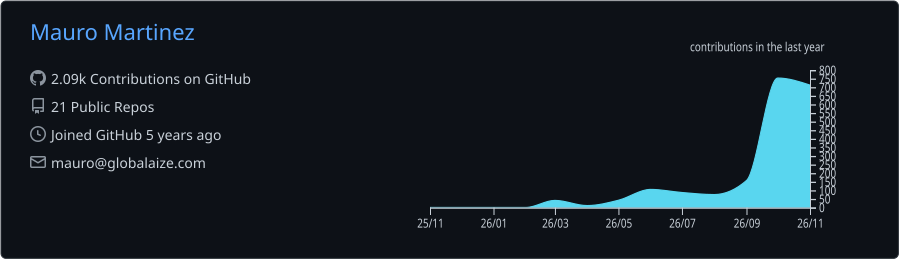

  

  

  <strong>I build AI automations, data pipelines, and BI dashboards for international trade and business operations, turning sourcing, customs, and logistics challenges into measurable business results.</strong>

<table width="100%">
  <tr>
    <td align="center" valign="top" width="33%">
      <h3>🚢 GlobalAIze International Sourcing SaaS | 24/7</h3>
      <h2>~220 quotes a month</h2>
      
10+ AI agents contact about 570 Chinese suppliers a month, write 99.9% of the messages and get prices 11% below list, with AI costs under USD 0.10 per quote.

    </td>
    <td align="center" valign="top" width="33%">
      <h3>🤖 Mercado Libre 24/7 Customer Q&amp;A Automation</h3>
      <h2>97% auto-answered</h2>
      
Answers buyer questions in 10 minutes (median), day and night, with no human intervention 97% of the time, at 95.8% less than the previous tool.

    </td>
    <td align="center" valign="top" width="33%">
      <h3>📊 AI-Powered Macroeconomic Reporting</h3>
      <h2>Runs itself in the cloud</h2>
      
Every business day it scrapes and validates the data and emails <strong>7 charts with AI conclusions + 9 slides</strong>, with no human intervention and zero running cost.

    </td>
  </tr>
</table>

  <strong>🧭 Quick navigation | Click a section</strong> 
  <a href="#user-content--about-me">About</a> |
  <a href="#user-content--key-achievements--impact">Achievements</a> |
  <a href="#user-content-%EF%B8%8F-tech-stack">Tech Stack</a> |
  <a href="#user-content--featured-projects">Projects</a> |
  <a href="#user-content--github-activity--profile-summary">Activity</a> |
  <a href="#user-content--lets-get-in-touch">Contact</a>

---

## 👤 About Me
I am an Argentine **🤖 Data Analytics & AI Automation Engineer** and **🎓 B.A. in International Trade** with Polish citizenship. Working in international trade since **2018**, I combine hands-on business experience with AI, data engineering, and analytics to automate operations and build commercial products.

* **Advanced English:** Extensive experience leading international negotiations and collaborating with multicultural teams (USA, China, India, Malaysia, Brazil).
* **Native Spanish:** Born and raised in Argentina.
* **Basic Chinese:** Began learning in 2018; applied to technical documentation and commercial relationships.
* **EU Citizen:** Open to Remote/Relocation opportunities.

   
  All third-party logos and trademarks are the property of their respective owners and are shown for identification only. Their use does not imply affiliation or endorsement.

---

## 💪 Key Achievements & Impact

- **Multi-Agent AI Sourcing SaaS:** Built an internal sourcing system and commercialized it as a SaaS offering operating **24/7**. Its 10+ AI agents find and negotiate with Chinese suppliers, support product classification through RAG, and generate interactive landed-cost quotations, while a web app and dashboard track key metrics, including costs. Since June 2026 it has contacted **about 570 suppliers and secured about 220 quotations a month**, at a median price **11% below the supplier's own listed price**. AI writes **99.9%** of the negotiation messages, 71% of them outside Argentine business hours while China is at work, with **AI costs under USD 0.10 per quotation**: the work of more than two people for under 2% of the cost of one entry-level employee in Argentina (estimate).
- **Mercado Libre Customer Q&A Bot:** Answers buyer questions **24/7**, checking every five minutes, with **97% answered without human intervention** and a median response time of **10 minutes**. 51% of questions arrive at night or on weekends and still get answered. The bot costs **95.8% less than the previous tool**, with AI usage at about USD 2 per month. A dashboard tracks response times and costs.
- **AI Cost Optimization:** Cut the monthly AI spend of the international negotiation agents by **96%** by optimizing model usage, splitting agents into modules and adding validation controls, while keeping **95%+ hand-reviewed accuracy** and fixing errors the previous setup made in production. A simple, customizable presentation builder in the web app also replaced AI-generated presentations, cutting that cost to almost zero.
- **AI-Powered Macroeconomic Reporting:** Built a **fully automated cloud pipeline** tracking **FX rates, country risk, interest rates, inflation, debt, and Bitcoin**, then emailing seven charts with AI-written insights and a nine-slide executive deck. Python calculates the indicators; Gemini writes the analysis.
- **Self-Service Analytics for Microsoft:** Reduced operational workload for Microsoft's global sales team by deploying a self-service `Power BI` solution, eliminating manual email-based queries (100% English-led role).

<b>More achievements & business impact</b>

- **AI Voice Agents:** Built voice agents on `Retell` with `ElevenLabs` voices, orchestrated through `n8n` and connected to business tools for stock checks, calendar booking, and general inquiries.
- **Process Automation:** Cut customs declaration errors to zero by replacing manual workflows with an automated `Power Query` ETL pipeline, which also made the task 90% faster.
- **Cost Efficiency:** Achieved a 50% reduction in FOB costs for a key product line through data-driven competitor benchmarking and supplier development, while also improving quality.
- **Supply Chain Optimization:** Identified critical bottlenecks in international logistics by merging multiple data sources and visualizing insights with `Power BI`, enabling real-time decision-making.
- **Department Foundations:** Built the Analytics unit from scratch for an international trade consultancy, delivering automated internal and client-facing BI reporting plus cross-functional analytics for Finance, C-Level, HR, International Trade, Logistics, and Sales.

---

## 🛠️ Tech Stack

### 💻 Programming & Automation

<table>
  <tr><td><b>Ingestion &amp; ETL</b></td><td></td></tr>
  <tr><td><b>Automation</b></td><td></td></tr>
  <tr><td><b>AI APIs</b></td><td></td></tr>
</table>

### 📊 Data Analytics & Power BI

<table>
  <tr><td><b>BI &amp; Viz</b></td><td></td></tr>
  <tr><td><b>Storage &amp; Data Ops</b></td><td></td></tr>
</table>

---

## 🚀 Featured Projects

### 🤖 AI & Automation

#### [AI-Powered Argentine Macroeconomic Reporting & Mailing Automation](https://github.com/mauroemartinez/RPA-exchange-rate-scraping-automatic-mailing)
*Automates Argentina's macro reporting (FX, country risk, interest rates, inflation, debt and Bitcoin) and emails charts, AI-written insights and an executive deck, with input validation, failure alerts and 260+ automated tests. Open source (Apache 2.0).*

* **Stack:** `Python`, `Pandas`, `Playwright`, `httpx`, `Pydantic`, `SQLAlchemy`, `Supabase`, `Gemini API`, `Jinja2`, `Matplotlib`, `Seaborn`, `python-pptx`, `Streamlit`, `Plotly`, `Cloudflare Workers`, `GitHub Actions`, `Streamlit Community Cloud`, `pytest`.

  

  <a href="https://view.officeapps.live.com/op/view.aspx?src=https%3A%2F%2Fraw.githubusercontent.com%2Fmauroemartinez%2FRPA-exchange-rate-scraping-automatic-mailing%2Freporte-ejecutivo%2FReporte%2520Ejecutivo.pptx"><b>▶️ View the latest deck online</b></a>
  &nbsp;&nbsp;·&nbsp;&nbsp;
  <a href="https://macro-argentina-globalaize.streamlit.app/?lang=en"><b>📊 Explore the interactive version</b></a>

  

#### [LLM Cost & Quality Bench](https://github.com/mauroemartinez/llm-cost-quality-bench)
*Measures what an LLM costs and how often it is right on a B2B negotiation task, comparing one big agent with modular agents and validation guards, on 100% synthetic data. Open source (Apache 2.0).*
* **Stack:** `Python`, `Pydantic`, `Polars`, `Matplotlib`, `httpx`, `pytest`, `GitHub Actions`.

  

<b>More AI & automation projects</b>

#### [Argentine Import Data Toolkit (ARCA)](https://github.com/mauroemartinez/analisis_datos_comex_arca)
*Downloads every monthly import file published by ARCA into a single Parquet history and queries it by importer, NCM code or free SQL, with tutorial notebooks and a serverless web explorer. Open source (MIT).*
* **Stack:** `Python`, `DuckDB`, `DuckDB-WASM`, `Polars`, `Pandas`, `PyArrow`, `Parquet`, `Matplotlib`, `Jupyter`, `GitHub Pages`, `GitHub Actions`.
* **Try it online:** [mauroemartinez.github.io/analisis_datos_comex_arca/?demo=1](https://mauroemartinez.github.io/analisis_datos_comex_arca/?demo=1)

  

#### [Softrade Batch](https://github.com/mauroemartinez/softrade-batch)
*Claude Code skill that turns a plain-language request into batch downloads of international trade data from Softrade across 78 countries, with resumable runs and truncation checks. Open source (MIT).*
* **Stack:** `Claude Code`, `Claude in Chrome`, `Python`, `Excel`.

### 📊 Data Analytics & Power BI

#### [📊 LATAM Market Intelligence & Import Analytics](https://github.com/mauroemartinez/Latam_Imports_Market_Intelligence)
*Market share analysis and KPI visualization for importers across Latin America, designed to identify strategic partners.*
* **Stack:** `Power BI`, `DAX`, `Power Query`, `PBIP`, `Data Modeling`, `Python (pandas)`.

  

<b>More data analytics projects</b>

#### [🛡️ COVID-19 PPE Import Market Study](https://github.com/mauroemartinez/Importaciones_EPP_COVID-19_Pre_vs_Postpandemia)
*Compares Argentina's PPE imports in 2018 to 2019 and during the COVID-19 crisis in 2020 to 2021, showing how the market changed.*
* **Stack:** `Power BI`, `Power Query`, `International Trade Data`.

  

#### [👟 Sports Footwear Sales & Consumer Behavior](https://github.com/mauroemartinez/Sports_Footwear_Sales_and_Consumer_Behavior_Analysis-Technical_Challenge)
*Power BI analysis of 30,000 orders from a public Kaggle dataset, with a star schema, time intelligence, field parameters and SVG charts drawn in DAX that show each country's flag.*
* **Stack:** `Power BI`, `Power Query`, `DAX`, `SVG`, `Star Schema`, `Time Intelligence`, `Python`.

  

#### [📉 Customer Churn & Behavior Analysis](https://github.com/mauroemartinez/Customer_Churn_and_Behavior_Analysis-Technical-Challenge)
*Churn analysis of 10,900 customers from four source files, with churn rates that hold for any province, plan or campaign, and one clear finding: 97.6% of the customers who left were not in the retention campaign list.*
* **Stack:** `Power BI`, `Power Query`, `DAX`, `Star Schema`.

  

---

## 📈 GitHub Activity & Profile Summary

  

---

## 📫 Let's get in Touch

* 🌐 **Website:** [www.globalaize.com](https://www.globalaize.com)
* 💼 **LinkedIn:** [/in/mauroemartinez](https://www.linkedin.com/in/mauroemartinez/)
* 📧 **Email:** [mauro@globalaize.com](mailto:mauro@globalaize.com)
* 📱 **WhatsApp:** [+54 9 11 5990-9647](https://wa.me/5491159909647?text=Hola%20Mauro%2C%20%C2%BFc%C3%B3mo%20est%C3%A1s%3F%20Vi%20tu%20perfil%20de%20IA%20%2B%20Comex%20en%20GitHub%20y%20me%20gustar%C3%ADa%20contactarte.)
* 🌍 **Availability:** Open to 100% Remote (Worldwide) or Relocation.
* ⚖ **Legal:** Argentine & EU Passport Ready (No sponsorship required for EU-based roles).
* 📍 **Current Location:** Buenos Aires, Argentina.

---

  <i>"AI &amp; data to solve global trade problems."</i>

---

