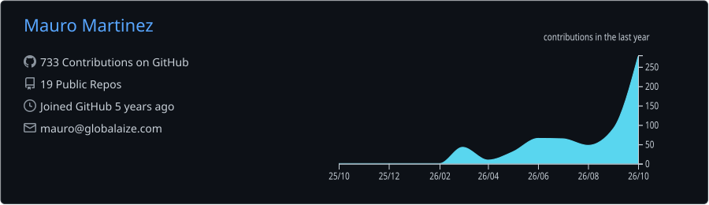

  

  

  <strong>I build AI automations, data pipelines, and BI dashboards for international trade and business operations, turning sourcing, customs, and logistics challenges into measurable business results.</strong>

| **10+ AI agents** | **Every 5 minutes** | **7 charts + 9 slides** |
| :---: | :---: | :---: |
| Commercial sourcing SaaS | Mercado Libre Q&A cycle | Automated daily macro reporting |

  <a href="#user-content--about-me">About</a> |
  <a href="#user-content--key-achievements--impact">Achievements</a> |
  <a href="#user-content-%EF%B8%8F-tech-stack">Tech Stack</a> |
  <a href="#user-content--featured-projects">Projects</a> |
  <a href="#user-content--github-activity--profile-summary">Activity</a> |
  <a href="#user-content--lets-get-in-touch">Contact</a>

---

## 👤 About Me
I am an Argentine **🤖 AI Automation and Analytics Engineer** and **🎓 B.A. in International Trade** with Polish citizenship. Working in international trade since **2018**, I combine hands-on business experience with AI, data engineering, and analytics to automate operations and build commercial products.

* **Advanced English:** Extensive experience leading international negotiations and collaborating with multicultural teams (USA, China, India, Malaysia, Brazil).
* **Native Spanish:** Born and raised in Argentina.
* **Basic Chinese:** Applied to technical documentation interpretation and building commercial trust.
* **EU Citizen:** Open to Remote/Relocation opportunities.

---

## 💪 Key Achievements & Impact

- **Multi-Agent AI Sourcing SaaS:** Built an internal sourcing system and commercialized it as a SaaS offering. Its 10+ AI agents find and negotiate with Asian suppliers, support product classification through RAG, and generate interactive landed-cost quotations. A web app tracks costs and negotiations, targeting a lead-to-quotation cycle under 72 hours.
- **Mercado Libre Customer Q&A Bot:** Automated buyer-question responses on a five-minute cycle, improving average response times and company visibility on the marketplace while eliminating the manual work previously required to answer those questions.
- **AI-Powered Macroeconomic Reporting:** Built an unattended pipeline tracking **FX rates, country risk, interest rates, inflation, monetary aggregates, public and private debt, and Bitcoin**. Delivers a daily HTML report with seven charts and a nine-slide executive deck: Python computes the indicators; Gemini writes the commentary. Automated validation, duplicate-run protection, failure alerts, and 260+ offline tests support reliable delivery through Cloudflare Workers and GitHub Actions on free plans.
- **Self-Service Analytics for Microsoft:** Reduced operational workload for Microsoft's global sales team by deploying a self-service `Power BI` solution, eliminating manual email-based queries (100% English-led role).

<b>More achievements & business impact</b>

- **Process Automation:** Eliminated 100% of manual errors in customs declarations by replacing legacy workflows with an automated `Power Query` ETL pipeline, cutting task time by 90%.
- **Cost Efficiency:** Achieved a 50% reduction in FOB costs for a key product line through data-driven competitor benchmarking and supplier development.
- **Supply Chain Optimization:** Identified critical bottlenecks in international logistics by merging multiple data sources and visualizing insights with `Power BI`, enabling real-time decision-making.
- **Department Foundations:** Built the Analytics unit from scratch for an international trade consultancy, delivering client-facing services plus cross-functional support to Finance, C-Level, HR, International Trade, Logistics, and Sales.

---

## 🛠️ Tech Stack

| Category | Tools |
| :--- | :--- |
| **Ingestion & ETL** |      |
| **BI & Viz** |       |
| **Storage & Data Ops** |     |
| **Automation** |      |
| **AI APIs** |    |

---

## 🚀 Featured Projects

### [💼 Professional Data Portfolio (Slide Deck)](https://docs.google.com/presentation/d/1CYxJus8K5OhROraqleF-ntOejzjPTLRBven9R5F1C0o/edit?usp=sharing)
*A comprehensive showcase of my analytical approach to easily be read by anyone, featuring end-to-end projects, business impact, and visualization standards.*

  

### [🤖 AI-Powered Argentine Macroeconomic Reporting](https://github.com/mauroemartinez/RPA-exchange-rate-scrapping-automatic-mailing)
*From market data to executive reporting, without manual compilation. Tracks Argentine FX rates, country risk, BCRA and Federal Reserve interest rates, inflation, monetary aggregates, public and private debt, and Bitcoin. Every business day at 16:00 Argentina time, the pipeline validates and stores the data in Supabase and delivers an HTML email with seven charts plus a nine-slide PowerPoint deck. Python computes the figures; Gemini adds structured commentary. The latest charts and deck are published automatically to the repository.*

* **Reliability:** Concurrent ingestion, schema validation, duplicate-run protection, AI model failover, failure alerts, and a daily completeness check. 260+ offline tests run in CI.
* **Stack:** `Python`, `Pandas`, `Playwright`, `httpx`, `Pydantic`, `Supabase`, `Gemini API`, `Jinja2`, `Matplotlib`, `Seaborn`, `python-pptx`, `Cloudflare Workers`, `GitHub Actions`, `pytest`.

  

  <i>Daily executive deck, built and published automatically by the pipeline.</i> 
  <a href="https://view.officeapps.live.com/op/view.aspx?src=https%3A%2F%2Fraw.githubusercontent.com%2Fmauroemartinez%2FRPA-exchange-rate-scrapping-automatic-mailing%2Freporte-ejecutivo%2FReporte%2520Ejecutivo.pptx"><b>▶️ View today's deck online</b></a>

<b>View pipeline architecture</b>

  

### [📊 LATAM Market Intelligence & Import Analytics](https://github.com/mauroemartinez/Latam_Imports_Market_Intelligence)
*Market share analysis and KPI visualization for potential importers across Latin America. Designed to identify strategic partners and competitive landscape shifts.*
* **Stack:** `Power BI`, `DAX`, `Power Query`,`Data Modeling`.

  

### [🛡️ COVID-19 PPE Import Market Study](https://github.com/mauroemartinez/Importaciones_EPP_COVID-19_Pre_vs_Postpandemia)
*A comprehensive market study of Personal Protective Equipment (PPE) imports in Argentina, comparing pre-pandemic (2018-2019) vs. COVID-19 crisis period (2020-2021).*
* **Stack:** `Power BI`, `Power Query`, `International Trade Data`.

  

### [👟 Sports Footwear Sales & Consumer Behavior](https://github.com/mauroemartinez/Sports_Footwear_Sales_and_Consumer_Behavior_Analysis-Technical_Challenge)
*Technical challenge for a BI Developer position. Integration of Python for automated data ingestion from Kaggle and advanced DAX for trend analysis and moving averages, as well as parameters to allow users to do plenty of axis combinations.*
* **Stack:** `Python`, `DAX`, `Star Schema`, `Time Intelligence`.

  

### [🏮 HSK Chinese Proficiency Vocabulary Analysis](https://github.com/mauroemartinez/HSK_Vocabulary)
*A statistical frequency analysis of HSK (1-6) vocabulary. Includes data normalization and visual insights to optimize learning paths based on character recurrence.*
* **Stack:** `Python`, `Pandas`, `Matplotlib` (Chinese Font configuration).

  

---

## 📈 GitHub Activity & Profile Summary

  

---

## 📫 Let's get in Touch

* 🌐 **Website:** [www.globalaize.com](https://www.globalaize.com)
* 💼 **LinkedIn:** [/in/mauroemartinez](https://www.linkedin.com/in/mauroemartinez/)
* 📧 **Email:** [mauro@globalaize.com](mailto:mauro@globalaize.com)
* 📱 **WhatsApp:** [+54 9 11 5990-9647](https://wa.me/5491159909647?text=Hola%20Mauro%2C%20%C2%BFc%C3%B3mo%20est%C3%A1s%3F%20Vi%20tu%20perfil%20de%20+IA+%2B+Comex+en+tu+%20GitHub%20y%20me%20gustar%C3%ADa%20contactarte.)
* 🌍 **Availability:** Open to 100% Remote (Worldwide) or Relocation.
* ⚖ **Legal:** Argentine & EU Passport Ready (No sponsorship required for EU-based roles).
* 📍 **Current Location:** Buenos Aires, Argentina.

---

  <i>"AI, data &amp; global trade. Built to solve real business problems."</i>

---

